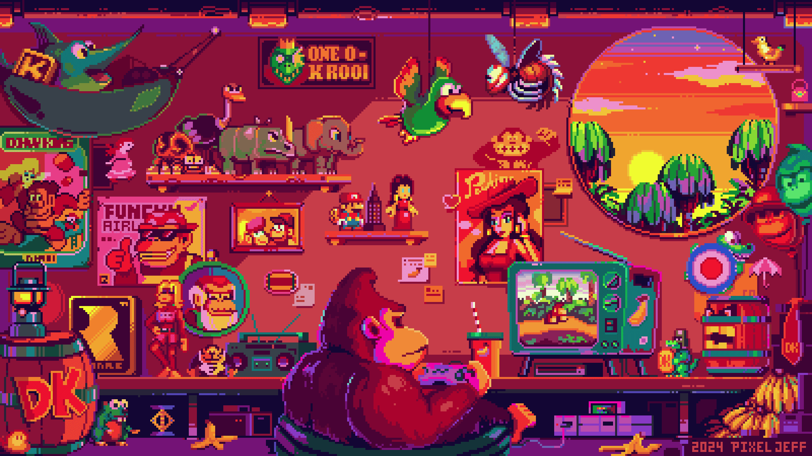
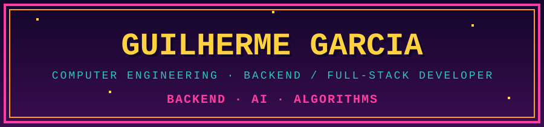
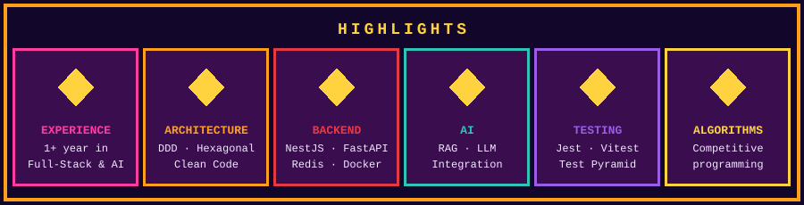
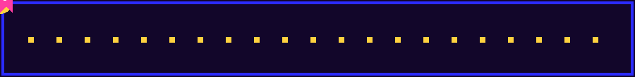

  
  

<h1 align="left">👋 Welcome to my profile!</h1>

## 👨‍💻 About Me

I'm **Guilherme Garcia Monteiro**, a Computer Engineering student at Unifor and a Full-Stack Developer Intern at Vortex 🇧🇷.

I enjoy solving problems, building backend systems, and exploring different areas of software development — from REST APIs and software architecture to competitive programming, artificial intelligence, and game development.

I have over a year of hands-on experience in Full-Stack and AI development. I build REST APIs with **NestJS/TypeScript** using **Domain-Driven Design** and **Hexagonal Architecture**, backed by automated tests and Docker, and AI solutions with **Python, FastAPI and RAG**. I care about clean code, performance, and working well in agile teams.

| | |
| :--- | :--- |
| **Role** | Full-Stack Developer Intern @ Vortex |
| **Education** | Computer Engineering @ Unifor · 8th semester |
| **Location** | Fortaleza, CE — Brazil 🇧🇷 |
| **Interests** | REST APIs, software architecture, competitive programming, AI, game development |
| **Goal** | Build projects that combine performance, clean architecture, and practical learning |

  

## 💼 Experience

| Period | Role | Organization |
| :--- | :--- | :--- |
| **Nov 2025 – Present** | Full-Stack & AI Development Intern | Vortex · Universidade de Fortaleza (Unifor) |
| **Aug 2025 – Present** | PET-Saúde Research Scholar — digital health culture and educational games | Universidade de Fortaleza (Unifor) |

## 🏆 Featured Projects

| Project | Description | Tech Stack |
| :--- | :--- | :--- |
| 👥 **[ReferralSystem](https://github.com/garc1a04/ReferralSystem)** | Full-stack referral management system focused on user relationships, custom invite links, and business rules. |  |
| 🧬 **[API-POKEDEX](https://github.com/garc1a04/Pokedex-Unifor)** | Pokémon image classification experiments using convolutional neural networks and image recognition techniques. |  |
| 🖼️ **[Image Processing API](https://github.com/garc1a04/image_processing)** | Image processing API built with Sharp and MinIO for file storage and transformation workflows. |  |
| 📖 **[IndiceRemissivo](https://github.com/garc1a04/IndiceRemissivo)** | Text indexing and cross-referencing system developed with data structures and parsing algorithms. |  |
| 🔍 **[Github-User-Code](https://github.com/garc1a04/Github-User-Code)** | Frontend application consuming the GitHub REST API to dynamically display developer information. |  |

## 🚀 Current Focus

- 🏗️ Building REST APIs and backend systems with **Java/Spring Boot**, **NestJS**, and **Clojure**
- 🧠 Studying **Artificial Intelligence & Machine Learning**
- ⚔️ Practicing **Competitive Programming** and problem solving

  

## 🛠️ Tech Stack

  

### 🧱 Architecture & Engineering Practices

  
  
  
  
  
  
  

### 🔌 Backend Capabilities

  
  
  
  
  
  
  

### 🤖 AI

  
  
  
  

### 🧭 Methodologies

  
  
  

## 📈 GitHub Activity

  
  
  

 

  

## 🤝 Let's Connect!

I'm always open to talking about backend development, algorithms, machine learning, or game development.

  
  
  

---

  

  
<i>Thanks for dropping by! See you in the code. 👾</i>

